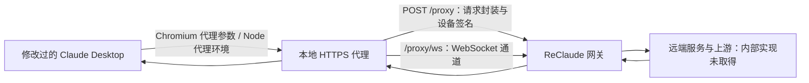

# ReClaude v1.5.1 转发机制与自建可行性

核对日期：2026-10-25，Asia/Singapore。

## 结论与范围

ReClaude 使用修改过的 Claude Desktop、本地 HTTPS 代理和带设备签名的远端隧道。客户端转发架构可以复现，但让完整 hosted Chat 使用自有推理服务，需要处理比 `/v1/messages` 更多的网页服务契约。

本次仅阅读安装文件、状态文件和已有日志，并在二进制副本上进行 IDA 静态分析。没有启动或停止 Claude/ReClaude、安装证书、改写运行配置，或发送账户、模型、推理请求。本文中的运行状态是检查时的快照，不是长期保证。

公开记录已移除本机用户名、账号绑定 ID、私有推理地址和凭证。没有提交安装包、完整 ASAR、IDA 数据库、会话数据或原始日志。

## 样本身份

| 组件 | 核对结果 |
|---|---|
| ReClaude daemon | v1.5.1；检查时正在运行 |
| 构建工具链 | Go 1.26.10，windows/amd64 |
| 构建源码提交 | `1b5e992021c48fd588ee81e63320a31eb61245c0` |
| EXE SHA-256 | `6DCC286D204FD93633C4E16CC1C8381759B26814BF95FAEAE2DA5EB216C9A385` |
| ReClaude 管理的 Desktop | 3.1623.1 |
| Desktop 补丁标记 | `__RECLAUDE_INJECTED_v7__` |
| 本机另一个官方 Desktop | 3.6556.2；检查时运行于 3P 模式，使用自定义推理网关 |
| daemon 保存的选定网关 | `https://edgeone.route.reclaude.ai` |

ReClaude 的既有更新日志在当日记录 `already on the latest version`，本次没有主动查询更新服务。因此版本结论限定为本机样本；ReClaude 管理的 Desktop 与官方 Desktop 不能混称为同一个版本。

文件来源：

- `%LOCALAPPDATA%/Programs/reclaude/bin/reclaude.exe`：Go build metadata 与当前二进制。
- `%USERPROFILE%/.reclaude/claude-app/metadata.json`：下载来源与 Desktop 版本。
- `%USERPROFILE%/.reclaude/claude-app/RECLAUDE_PATCH.json`：补丁规格、标记与 integrity_patched 状态。
- `%USERPROFILE%/.reclaude/claude-app/app/resources/app.asar`：实际注入代码、package.json 和主程序源码。
- `%USERPROFILE%/.rec/state.json` 与 `logs/daemon.log`：已有 daemon 状态和选线记录。
- `%USERPROFILE%/.rec/claude/accounts/<binding>/app/logs/`：既有 Desktop 页面加载日志。

## 转发链路

### 启动与账号隔离

`spawn.claudeAppCommandAndEnv` 构造本机代理地址，并使用 `--proxy-server=`、`--ignore-certificate-errors-spki-list=`、`--user-data-dir=`。`spawn.claudeProxyEnv` 负责 CLI/Node 代理环境；`spawn.ClaudeProfile.applyAppEnv` 设置 `CLAUDE_CONFIG_DIR`、`RECLAUDE_PROFILE`。

Chromium renderer 和 Node/Code 子进程需要各自的网络配置，单独设置 HTTPS_PROXY 不足以描述整个 Desktop 的转发机制。应用数据和 Code 配置按 `.rec/claude/accounts/<binding>/app`、`config` 分开保存。

检查时 daemon 的普通代理和透明代理端口分别为 59779、59782，均监听 loopback；这是本次快照，不应硬编码为实现契约。

### Electron 补丁

ASAR 入口 `.vite/build/index.pre.js` 在原程序之前执行 v7 补丁：

1. 包装 Electron session 的 `webRequest.onBeforeSendHeaders`，保留原监听器，再对 Anthropic/Claude 域加入 `x-reclaude-profile`。值取自 `RECLAUDE_PROFILE`，用于本地账号归属。
2. 从应用 JavaScript 可见的 argv/hasSwitch 结果中隐藏代理和证书等参数，避免原版启动检查拒绝这些条件；Chromium 原生层已经解析的代理设置仍然保留。
3. 处理本地 CA、Node 额外 CA 和 VM 的只读 CA 挂载。主 bundle 有两处实际调用点接入 `__reclaudeVmSpawn`。
4. 还包括时区、host loop、开发 URL override、自动更新和本地配对等行为调整。

这说明当前实现包含应用补丁，不能简化为只修改一个官方 API 配置项。补丁中存在 VM 路径，不等于已验证 Windows Cowork 的端到端可用性；已有 daemon 日志还出现过透明代理 helper 不可达。

### 拦截与域名路由

当前二进制 `mitm.map.init.1` 的内置表包含 `api.anthropic.com`、`.anthropic.com`、`claude.ai`、`claude.com`、`platform.claude.com`、`.claudeusercontent.com` 等。

`MatchFloorFor` 读取该内置表；`MatchFor` 处理匹配与附加规则。因此 `.rec/intercept-domains.json` 中动态 entries 为空，不表示没有拦截规则。

`mitm.(*Server).runRequestLoop` 读取 TLS 解密后的 HTTP 请求，调用 `tunnel.Identity.Forward`，并对 WebSocket 使用独立入口。非目标流量另有 passthrough 路径。

### 远端隧道协议

当前样本的调用与汇编证据支持以下结论：

- `tunnel.Identity.Forward` 构造原 URL、请求方法、headers 和跟踪信息等信封，向网关 `/proxy` 发起 POST，并调用设备签名函数。
- `tunnel.encodeEnvelope` 先 JSON 序列化信封，再写入 **4 字节大端长度、JSON、请求 body**。这不是直接向普通 Messages API 提交 JSON。
- `tunnel.Identity.forwardWebSocketWith` 使用 `/proxy/ws`，带 Base64 编码的 `X-Reclaude-Envelope`，同样经过设备签名路径。
- `deviceauth.Signer.AddSignatureHeaders` 调用随机数、SHA-256、时间与 Ed25519 签名函数，设置 `X-Reclaude-Device-Id`、`X-Reclaude-Ts`、`X-Reclaude-Nonce`、`X-Reclaude-Body-Sha256`、`X-Reclaude-Signature`。

所以普通 Anthropic 兼容 API 不能直接代替 ReClaude 的隧道接收端。自建客户端和网关可以定义自己的协议与认证，不必复制其设备身份或私有签名体系。

### 页面与后端的区别

当前 bundle 的 1P 主页面默认 `https://claude.ai`；已有运行日志记录了该页面被加载，且代理解析结果为 proxied。补丁允许 CLAUDE_AI_URL override，但开启 override 标记本身不会改变页面地址。

网页仍可认为自己访问 claude.ai，而 HTTPS 请求由本地代理转交远端网关。这解释了保留原界面与改变网络转发路径如何同时发生。

客户端材料没有揭示服务端如何选择真实上游账户、改写 Cookie/登录态、管理会话，或者哪些响应由其生成。不能据此断言他们完整重写了 claude.ai，也不能认为模拟本地登录就能取得真实推理能力。

## 与本仓库现有代码的区别

比较基线：[`b12d250`](https://github.com/EnvyGithub/reclaude-reverse/tree/b12d250171ab10cfa532489c7f8fb8b90d0bcd4a)。

| 项目 | 仓库现有实验代码 | 本机 v1.5.1 样本 |
|---|---|---|
| claude.ai | `shouldIntercept` 返回 false，透传 | 内置拦截表包含该域 |
| 普通请求的网关协议 | 转发原请求路径，Gateway 检查 X-SK-Token | `/proxy` 信封协议与设备签名 |
| Desktop 兼容 | launcher 设置环境后启动程序 | 安装包已注入 v7 补丁，并使用 Chromium 启动参数 |
| 多账号归属 | 网关 SK/token 池 | 本地 profile 隔离、归属头和设备身份 |

现有代码还存在已确认的静态问题：启动脚本未切换 forward 模式、自定义 anthropic-url 未用于实际转发、未鉴权的 `/stats` 返回完整 SK，以及配置中跟踪凭证字符串。见 [README](../../README.md)。本次仅记录，不修改这些行为，也未验证配置凭证是否有效。

## 自建可行性与建议边界

| 目标 | 判断与工作范围 |
|---|---|
| Desktop → 本地代理 → 自有服务器 | 可行；实现启动、CA、域名路由、流式 HTTP/WebSocket 和数据隔离 |
| 保留 1P 外壳，Code 页接自有 API | 适合作为首个验证目标；需要验证消息接口、认证映射、模型映射、SSE、工具调用及非推理服务依赖 |
| 完整 1P Chat 接自有推理 | 需要适配网页会话、组织、文件与流式协议，并确定身份和存储归属 |
| 完全脱离原网页服务，保持全部产品行为 | 当前证据不足以承诺，需要维护完整的兼容服务层 |
| 官方 3P 接自有 API | 官方支持；前端为 bundled local web app，与 hosted 1P 产品行为不同 |

建议首先在隔离副本上用离线 mock 验证 Code 页的消息、SSE 与工具调用链路，再决定是否扩展完整 Chat 服务适配。该建议不是已完成的实现，也不是原有账号、证书和会话的迁移操作。

## 证据强度与复核

[证据索引](reclaude-v1.5.1-evidence.json) 包含样本 hash、函数名、地址、关键代码片段与 bundle 偏移。Go 函数名通过 pclntab 恢复，使用 IDA 分析副本。部分 Go ABI 伪代码有变量分配警告，协议帧和签名结论已用汇编与数据引用交叉核对。

复核顺序：确认样本 hash；读取 Go build metadata；解析 ASAR 的 package.json 和实际入口；定位对应函数和字符串引用；用既有状态和日志区分代码能力与运行事实。无需运行 launcher、inject 或账户探测命令。

尚未验证：真实推理、最新官方 Desktop 对同一补丁的兼容性、ReClaude 私有服务端实现、完整 Chat/Cowork 迁移。旧日志中的成功或失败没有被当作本次实时测试结果。

## 官方文档

- [Desktop 架构](https://claude.com/docs/third-party/claude-desktop/overview)：标准模式从 claude.ai 加载网页；3P 使用本地 bundled web app 与配置的 provider。
- [Desktop 配置](https://claude.com/docs/third-party/claude-desktop/configuration)：gateway、认证与模型配置契约。
- [Desktop gateway 与 CLI 配置区别](https://code.claude.com/docs/en/llm-gateway-connect#desktop-app)。
