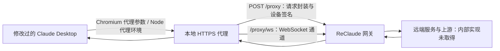
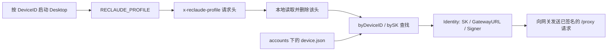
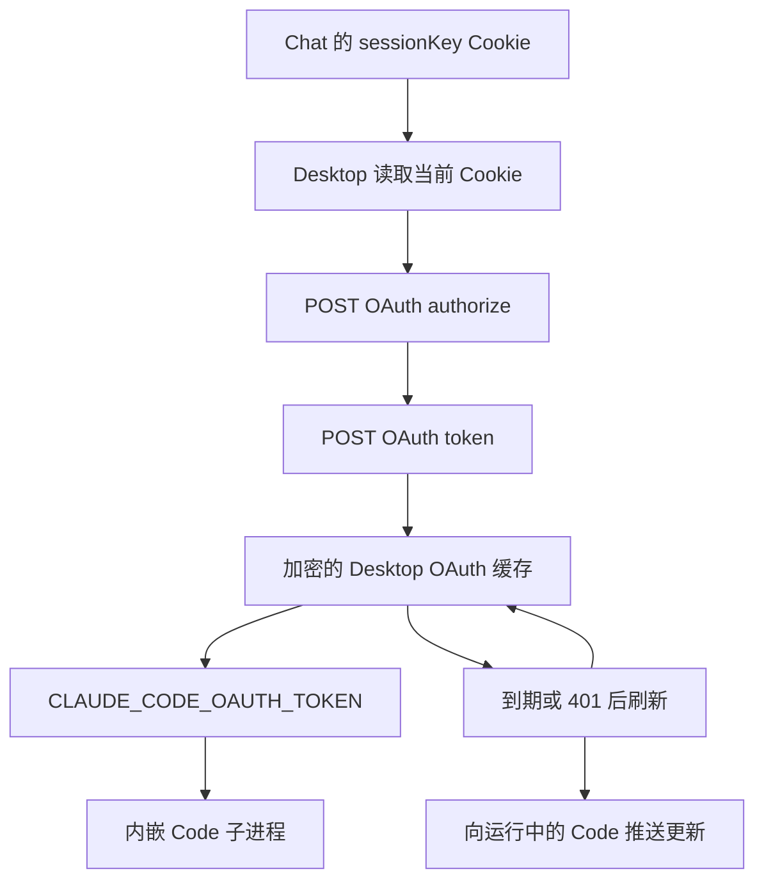

# ReClaude v1.5.1 架构、隧道协议与登录机制分析

核对日期：2026-10-25，Asia/Singapore。

## 结论与范围

ReClaude 使用修改过的 Claude Desktop、本地 HTTPS 代理和带设备签名的远端隧道。本机现存档案的离线比对进一步确认：Chat 的 `sessionKey`、Desktop 内嵌 Code 的缓存 access token、独立 Code 配置文件的 `accessToken`，均与该档案的 ReClaude SK 完全相同。它在客户端使用自己的代理凭证，并将其放入 Claude 客户端可以消费的 Cookie/OAuth 数据结构。

这支持“代理凭证 → 网关身份映射/认证适配 → 上游服务”的架构判断，但没有取得私有服务端实现。具体上游凭证、账号池、是否使用容器，以及哪些响应被生成或改写，仍不能作为已确认事实。

| 证据层次 | 已得到的结论 |
|---|---|
| 当前样本静态证据 | 请求封装、设备签名、profile 路由、合成 Code 凭证、Desktop Cookie/OAuth 消费与刷新路径 |
| 本机现存数据的离线证据 | 当前档案的 Chat Cookie、Desktop Code 缓存及 CLI access token 与 ReClaude SK 相同 |
| 与证据相符的推断 | 网关使用自有凭证做身份映射，并对部分认证或上游访问进行适配 |
| 尚未证明 | 首次 Cookie 写入响应、网关逐接口行为、真实上游登录态、容器/VM 拓扑、当前在线可用性 |

本次阅读安装文件、已有状态和日志，在二进制副本上进行官方 IDA MCP 静态分析，并离线解密目标档案的 Cookie 与 OAuth 缓存，只在进程内比较凭证。没有启动或停止 Claude/ReClaude、安装证书、改写其运行配置，或发送新的登录、账户、额度、OAuth、模型与推理请求。本文中的状态均为本机快照或历史记录，不是长期保证。

公开记录已移除本机用户名、账号绑定 ID、私有推理地址和凭证。没有提交安装包、完整 ASAR、IDA 数据库、原始会话数据或原始日志。

## 样本身份

| 组件 | 核对结果 |
|---|---|
| ReClaude daemon | v1.5.1；检查时正在运行 |
| 构建工具链 | Go 1.26.10，windows/amd64 |
| 构建源码提交 | `1b5e992021c48fd588ee81e63320a31eb61245c0` |
| EXE SHA-256 | `6DCC286D204FD93633C4E16CC1C8381759B26814BF95FAEAE2DA5EB216C9A385` |
| ReClaude 管理的 Desktop | 3.1623.1 |
| app.asar SHA-256 | `492AA20983454EC250427B5C2F41E4B3881A00D7BA45629D4B0BE936C3F55C62` |
| Desktop 补丁标记 | `__RECLAUDE_INJECTED_v7__` |
| 本机另一个官方 Desktop | 3.6556.2；检查时运行于 3P 模式，使用自定义推理网关 |
| daemon 保存的选定网关 | `https://edgeone.route.reclaude.ai` |

ReClaude 的既有更新日志在当日记录 `already on the latest version`，本次没有主动查询更新服务。因此版本结论限定为本机样本；ReClaude 管理的 Desktop 与官方 Desktop 不能混称为同一个版本。

文件来源：

- `%LOCALAPPDATA%/Programs/reclaude/bin/reclaude.exe`：Go build metadata 与当前二进制。
- `%USERPROFILE%/.reclaude/claude-app/metadata.json`：下载来源与 Desktop 版本。
- `%USERPROFILE%/.reclaude/claude-app/RECLAUDE_PATCH.json`：补丁规格、标记与 integrity_patched 状态。
- `%USERPROFILE%/.reclaude/claude-app/app/resources/app.asar`：实际注入代码、package.json 和主程序源码。
- `%USERPROFILE%/.rec/state.json` 与 `logs/daemon.log`：已有 daemon 状态和选线记录。
- `%USERPROFILE%/.rec/claude/accounts/<binding>/app/logs/`：既有 Desktop 页面加载日志。
- `%USERPROFILE%/.rec/claude/current`：选择离线检查的当前档案，公开记录使用别名 B1。
- 对应档案的 `device.json`、`config/.credentials.json`、`app/Network/Cookies`、`app/Local State`、`app/config.json`：仅用于离线凭证关系与元数据检查，不公开原值。

## 转发链路



### 启动与账号隔离

`spawn.claudeAppCommandAndEnv` 构造本机代理地址，并使用 `--proxy-server=`、`--ignore-certificate-errors-spki-list=`、`--user-data-dir=`。`spawn.claudeProxyEnv` 负责 CLI/Node 代理环境；`spawn.ClaudeProfile.applyAppEnv` 设置 `CLAUDE_CONFIG_DIR`、`RECLAUDE_PROFILE`。

Chromium renderer 和 Node/Code 子进程需要各自的网络配置，单独设置 HTTPS_PROXY 不足以描述整个 Desktop 的转发机制。应用数据和 Code 配置按 `.rec/claude/accounts/<binding>/app`、`config` 分开保存。

检查时 daemon 的普通代理和透明代理端口分别为 59779、59782，均监听 loopback；这是本次快照，不应硬编码为实现契约。

### profile 到本地账号绑定的映射

本节通过官方 IDA MCP 读取同一 v1.5.1 IDB 的汇编、调用关系和 Go 类型元数据，并与 v7 补丁代码核对。这里的“账号”指本地 ReClaude binding；不能据此确定远端最终使用的上游账号。



**配置来源与索引。** `config.ScanBindings` 枚举账号目录，通过 `LoadBinding` 读取 `<AccountsDirPath()>/<十进制 DeviceID>/device.json`。默认 `AccountsDirPath` 为 `IdentityDirPath("claude")/accounts`，本机布局对应 `.rec/claude/accounts/`。`config.Device` 的类型元数据包含 `sk`、`device_id`、`gateway_url`、`org_id` 等字段；`DeviceID` 和 `OrgID` 是不同字段，路由索引使用前者。这些结构与路由结论来自二进制静态分析；后续本机凭证比对单独记录在登录章节和脱敏核验文件中。

`buildClaudeBindingTable` 为每个 Device 构建 `Identity{SK, GatewayURL, SignerFor(device)}`，保存 `byDeviceID`、`bySK`、`deviceOf`、默认 Identity 和条目数。重复 DeviceID 跳过；重复 SK 保留先插入的映射。默认项先取首个有效条目，遇到传入的默认 DeviceID 时替换。`SetClaudeBindings` 通过原子指针替换整张表。`loadClaudeBindings` 负责扫描及应用运行时网关设置，并读取 `CurrentBinding`；当前选择与错误分支不能一概等同于“目录第一个账号”。

**请求归属。** `ClaudeProfile.applyAppEnv` 在对应 ID 为正数时生成十进制 `RECLAUDE_PROFILE`。v7 JS 补丁检查 `^[0-9]{1,20}$`，只向匹配 Anthropic/Claude 域的请求添加 `x-reclaude-profile`。daemon 的 `resolveClaudeBinding` 读取该头的第一个值、去除首尾空白，并在生成隧道信封之前从请求头中删除它。

`claudeBindingQuery.lookup` 的实际优先级如下；每一级命中即返回，不要求所有标识同时相符：

| 顺序 | 输入 | 查找方式 |
|---|---|---|
| 1 | `X-Reclaude-Profile` | `parseProfileDeviceID` 后查 `byDeviceID` |
| 2 | `Authorization: Bearer …` | 提取 token 后精确查 `bySK`；Bearer 前缀不区分大小写 |
| 3 | 名为 `sessionKey` 的 Cookie | Cookie 值精确查同一 `bySK` |
| 4 | 均未命中 | 返回默认 Identity，并将“明确命中”标志置为 false |

profile 的 daemon 侧校验比 JS 正则更严格：必须为 1–20 位 ASCII 数字，能解析为正的 `int64`。格式错误、数值溢出、零以及未知 DeviceID 都不算 profile 命中。未知有效 profile 或未命中的 ReClaude SK 可生成刷新提示；若配置了刷新回调，`resolveClaudeBinding` 调用后会重新读取表，再查一次。无效或未收录的 profile 还会触发告警，但一般请求不会仅因该头无效就立即拒绝。

**OAuth token 请求的例外。** `routeClaudeRequest` 对 `api.anthropic.com`、`platform.claude.com` 上的 POST，且路径符合 `^/v1/oauth/(?:[^/]+/)?token$` 的请求单独处理。若上述查找没有明确命中，会尝试解析不超过 64 KiB 的请求 body，从 JSON 或 `application/x-www-form-urlencoded` 的 `refresh_token` 中提取归属，再查 `byDeviceID`。若仍不能归属且表中有多个 DeviceID，本地生成 HTTP **503**、`temporarily_unavailable` 响应，而不是把 token 请求交给默认账号；单账号时仍可使用默认项。

此归属格式来自客户端的占位 refresh token 标记：`TagRefreshToken` 只把完全等于 `not-used-by-reclaude` 或 `managed-by-reclaude` 的字符串变为 `<占位值>:<DeviceID>`，其他 token 原样保留。`RefreshTokenDeviceID` 也只接受这两个前缀和正整数后缀。对应响应回调只处理状态 200、body 存在、`Content-Encoding` 为空或 `identity` 的 token 响应：最多读取 65,537 字节用于判定，仅对不超过 65,536 字节的合法 JSON 尝试改写 `refresh_token`；成功改写后更新 Content-Length 并清除 chunked 标记。读取失败、超限或内容不符合条件时恢复已读前缀和剩余 reader，避免丢失 body。它是普通响应流路径之外的一个有限缓冲分支，不代表任意 OAuth token 都被重写。

主要证据入口：`buildClaudeBindingTable` `0x1403C6720`、`resolveClaudeBinding` `0x1403C6CA0`、`claudeBindingQuery.lookup` `0x1403C70A0`、`routeClaudeRequest` `0x1403CCDA0`、`tokenRequestDeviceID` `0x1403CD6A0`。具体类型布局、字符串和分支地址见证据索引的 `proxy_profile_analysis`。

### Electron 补丁

ASAR 入口 `.vite/build/index.pre.js` 在原程序之前执行 v7 补丁：

1. 包装 Electron session 的 `webRequest.onBeforeSendHeaders`，保留原监听器，再对 Anthropic/Claude 域加入 `x-reclaude-profile`。值取自 `RECLAUDE_PROFILE`，用于本地账号归属。
2. 从应用 JavaScript 可见的 argv/hasSwitch 结果中隐藏代理和证书等参数，避免原版启动检查拒绝这些条件；Chromium 原生层已经解析的代理设置仍然保留。
3. 处理本地 CA、Node 额外 CA 和 VM 的只读 CA 挂载。主 bundle 有两处实际调用点接入 `__reclaudeVmSpawn`。
4. 还包括时区、host loop、开发 URL override、自动更新和本地配对等行为调整。

这说明当前实现包含应用补丁，不能简化为只修改一个官方 API 配置项。补丁中存在 VM 路径，不等于已验证 Windows Cowork 的端到端可用性；已有 daemon 日志还出现过透明代理 helper 不可达。

### 拦截与域名路由

当前二进制 `mitm.map.init.1` 的内置表包含 `api.anthropic.com`、`.anthropic.com`、`claude.ai`、`claude.com`、`platform.claude.com`、`.claudeusercontent.com` 等。

`MatchFloorFor` 读取该内置表；`MatchFor` 处理匹配与附加规则。因此 `.rec/intercept-domains.json` 中动态 entries 为空，不表示没有拦截规则。

`mitm.(*Server).runRequestLoop` 读取 TLS 解密后的 HTTP 请求，调用 `tunnel.Identity.Forward`，并对 WebSocket 使用独立入口。非目标流量另有 passthrough 路径。

### 远端隧道协议

当前样本的调用与汇编证据支持以下结论：

- `tunnel.Identity.Forward` 构造原 URL、请求方法、headers 和跟踪信息等信封，向网关 `/proxy` 发起 POST，并调用设备签名函数。
- `tunnel.encodeEnvelope` 先 JSON 序列化信封，再写入 **4 字节大端长度、JSON、请求 body**。这不是直接向普通 Messages API 提交 JSON。
- `tunnel.Identity.forwardWebSocketWith` 使用 `/proxy/ws`，带 Base64 编码的 `X-Reclaude-Envelope`，同样经过设备签名路径。
- `deviceauth.Signer.AddSignatureHeaders` 调用随机数、SHA-256、时间与 Ed25519 签名函数，设置 `X-Reclaude-Device-Id`、`X-Reclaude-Ts`、`X-Reclaude-Nonce`、`X-Reclaude-Body-Sha256`、`X-Reclaude-Signature`。

所以普通 Anthropic 兼容 API 不能直接代替 ReClaude 的隧道接收端。自建客户端和网关可以定义自己的协议与认证，不必复制其设备身份或私有签名体系。

#### `/proxy` 请求字段与编码

`newRequestEnvelopeBytes` 使用的实际 Go 类型是 `tunnel.ClientRequestMetadata`（类型地址 `0x140554D80`，大小 80 字节）。字段名和 `omitempty` 来自该类型的 JSON tag，不是根据相邻字符串猜测：

| JSON 字段 | Go 类型 | 当前普通 Forward 路径的来源 |
|---|---|---|
| `url` | `string` | 原请求 `req.URL.String()` |
| `method` | `string` | 原请求方法 |
| `headers` | `map[string]string` | `lowerCaseHeaders(req)` |
| `traceId` | `string`，omitempty | `newTraceID()` |
| `edge` | `string`，omitempty | `config.EdgeLabel(Identity.GatewayURL)` |
| `keepalive` | `bool`，omitempty | 初始化模板设为 true |

`headers` 的键转为小写，同名多值以 `", "` 合并，空值列表跳过；`req.Host` 非空时写入 `host`。若原请求存在 `accept-language`，其值改为 `en-US,en;q=0.9`；原本不存在则不额外添加。该 map 中的认证信息属于原请求，和外层隧道请求使用 `Identity.SK` 生成的 Bearer 认证是两个层次。`profile` 不是独立 JSON 字段；归属头已在前述本地路由阶段剥离。

外层为 `POST <GatewayRequestURL>/proxy`，Content-Type 为 `application/octet-stream`。body 布局是：

```text
uint32_be(JSON 字节数) | UTF-8 JSON metadata | 原请求 body 字节
```

`encodeEnvelope` 依次写入长度、JSON，再复制 body；元数据长度超过 uint32 范围时返回错误。`newRequestEnvelopeBytes` 的写入目标是 `bytes.Buffer`，随后 `Forward` 用完整结果构造请求、计算签名并调用 HTTP Client。因此当前普通请求路径会先缓冲完整信封和请求 body；不能把它描述为上传时直接透传原 reader。样本没有在这个 helper 中给请求 body 设置与响应元数据相同的 16 MiB 限制。

#### `/proxy` 响应字段、keepalive 与流

外层网关 HTTP 状态 **只有等于 200** 才进入信封解码；非 200 时 `Forward` 返回原网关响应，不把其 body 当作信封。200 分支使用 `tunnel.GatewayResponseMetadata`（类型地址 `0x14054D7A0`，大小 64 字节）：

| JSON 字段 | Go 类型 | 客户端用途 |
|---|---|---|
| `status` | `int` | 重建面向 Desktop 的 HTTP 状态码 |
| `statusText` | `string`，omitempty | 状态文本；空值时使用 `http.StatusText(status)` |
| `headers` | `map[string]string` | 重建 HTTP 响应头 |
| `events` | `[]tunnel.ReclaudeEvent`，omitempty | 与响应一起返回的元数据事件，和 body 中的 SSE 是不同层次 |
| `keepalive` | `bool`，omitempty | 为 true 时丢弃该帧元数据并继续读取下一帧 |

`ReclaudeEvent` 包含 `kind`、`reason`、`retryAfterSec`、`daysLeft`、`newAccountMaskedEmail`；后四项均有 `omitempty`。这些字段说明客户端可接收何种元数据，不能单凭字段名推出服务端实际账号切换策略。当前检查的 `runRequestLoop` 会遍历返回的 events 并记录 kind。

响应解码和交付顺序已由汇编确认：

1. `decodeEnvelope` 精确读取 4 字节大端长度，再精确读取相应数量的 JSON 字节；单帧元数据最大 **16 MiB（含等于）**。不足、超限或 JSON 无效均返回错误。该限制针对元数据，不是后续响应 body。
2. `DecodeResponse` 循环跳过 `keepalive:true` 帧。首个 `keepalive:false`（或省略字段）的帧给出最终 metadata；其后的 reader 直接返回为 body。没有在该层逐条解析 SSE，也没有对最终 body 再逐帧解信封。keepalive 帧后不能附加未声明的 body，否则下一次 4 字节读取会把它当成新帧长度。
3. `Forward` 在调用 `DecodeResponse` 前启动一次 **300 秒**计时器，超时回调关闭网关 body；解码返回后停止计时器。因此它约束等待最终 metadata 的总时间，keepalive 不会在这个函数中重置计时器，也不是整个 SSE body 的 300 秒时限。底层 HTTP Client、context 或网络仍可能有其他限制。
4. 最终响应重建为 HTTP/1.1，默认 `ContentLength=-1`、TransferEncoding 为 `chunked`。若 metadata headers 中的 Content-Length 可解析为 int64，则设置该长度并清除 chunked 标记。普通响应 body 包装原 reader 和 closer，关闭时释放网关响应；可选调试 tee、统计 reader 不改变这一基本结构。
5. `copyHeaders` 将普通头设置为单个值；对 `set-cookie` 专门拆分并逐个添加。拆分器在逗号后检测新的 `name=` 起点，避免把 Expires 日期中的逗号直接当成分隔符。写回前 `stripHopByHopHeaders` 删除 Connection 指定的头和固定 hop-by-hop 头，再由 `http.Response.Write` 输出状态、头与 body。token 回调的有限缓冲/改写例外见上节。
6. 正常写完后关闭 body；下游写入失败时进入 `drainResponseBody`，尝试把剩余 body 复制到 discard 后再关闭。这个路径不等于“下游断开会立即取消上游”，也不构成长期流稳定性验证。

外层非 200 响应、成功信封中的 `status`、本地隧道错误应分开理解。`writeTunnelError` 对 `ForwardError` 分类值 1 返回 **400 / invalid_request_error**，其他错误返回 **502 / api_error**。`Forward` 中编码请求和签名失败走分类 1；构造 HTTP 请求、发送及响应信封解码失败走另一类。以上均为静态控制流结论，没有向网关发送测试请求。

主要证据入口：`newRequestEnvelopeBytes` `0x1403BEF80`、`DecodeResponse` `0x1403BD2A0`、`decodeEnvelope` `0x1403BD620`、`copyHeaders` `0x1403BFB60`、`writeTunnelError` `0x1403CA160`。关键长度、计时器、分支及 JSON tag 地址收录在证据索引中。

### 页面与后端的区别

当前 bundle 的 1P 主页面默认 `https://claude.ai`；已有运行日志记录了该页面被加载，且代理解析结果为 proxied。补丁允许 CLAUDE_AI_URL override，但开启 override 标记本身不会改变页面地址。

网页仍可认为自己访问 claude.ai，而 HTTPS 请求由本地代理转交远端网关。这解释了保留原界面与改变网络转发路径如何同时发生。

客户端材料没有揭示服务端如何选择真实上游账户、改写 Cookie/登录态、管理会话，或者哪些响应由其生成。不能据此断言他们完整重写了 claude.ai，也不能认为模拟本地登录就能取得真实推理能力。

## 登录凭证：签发、写入与使用

本节区分 ReClaude 登录、独立 CLI 的合成凭证、Desktop 内嵌 Code 的 OAuth 流程，以及本机保存数据的实际比对。静态代码描述客户端预期读取哪些响应；它不等于取得了一份服务端原始登录响应。

### ReClaude 登录提供的身份

`login.RunWithOptions` 调用 `/api/cli/auth/start`，处理返回的 `state`、`verification_uri`、轮询间隔和有效期，再向 `/api/cli/auth/poll` 发送 state。启动请求的类型包含 hostname、OS、arch、public_key、machine_hash、machine_info、platform、capabilities 和可选 org_id。设备签名密钥可在本地生成，随后保存；公钥随登录请求提供给服务端。

客户端解析的 `login.pollResponse` 包含 `status`、`sk`、`device_id`、`gateway_url`、`user_email`、`account_uuid`、`organization_uuid`、`reused`、`device_name`、`platform`。这里没有 Claude OAuth 的 access/refresh token 字段。`persistApprovedDevice` 将授权结果转为本地 Device，进入 Claude 登录收尾并保存配置。

另一路 `FetchAccount` 使用 Device SK 的 Bearer 认证和设备签名访问网关 `/client/account`。成功响应按 `AccountInfo` 解析，包含邮箱、账号/组织 UUID、显示名、计费描述、时区、eligibility 与 client requirements 等资料。客户端会将这些资料同步到本地配置；它们不是“已取得真实上游 Cookie”的证据。

### 独立 Code 配置文件的合成凭证

`finalizeClaudeLogin` 在账号的 `config` 目录调用 `claudehome.WriteCredentials`。类型 `claudehome.CredentialsFile` 内嵌 `claudeAiOauth`，其字段实际写入方式如下：

| 字段 | 写入来源 |
|---|---|
| `accessToken` | 从 Device 原样传入的 ReClaude SK |
| `refreshToken` | `TagRefreshToken("not-used-by-reclaude", DeviceID)` |
| `expiresAt` | 当前 UTC 时间加十个日历年，转为 Unix 毫秒 |
| `scopes` | 本地固定列表：inference、profile、claude_code sessions、MCP、文件上传、design read/write |
| `subscriptionType` | 固定字符串 `max` |

`MergeConfig` 写入 `.claude.json` 的 `hasCompletedOnboarding=true`、`oauthAccount`、`userID`，保留合并逻辑。`credentialsNeedHeal`/`HealIfWiped` 提供文件缺失、空白、不可解析或 access token 为空后的重建路径；这不是对任意失效状态都可恢复的保证。

十年期限、scope 和 `max` 均是客户端兼容资料，不会独立授予上游权限；真实请求是否被接受仍取决于网关。这条文件路径也不能直接替代下一节 Desktop 内嵌 Code 的 token 管理逻辑。

### Desktop Chat 到内嵌 Code 的认证链

对当前 ASAR 提取的 bundle 进行了哈希复核。以下是该安装包的实际代码路径；没有与干净的同版官方包做完整差分，因此不将其笼统称为“未修改的官方实现”。



- `Rwn` 从 Electron 默认 session 读取 `sessionKey`；严格路径要求 Secure/HttpOnly。Chat 账号信息还可通过 `/api/bootstrap` 回填，但代码存在登出状态、身份变化等检查，不是无条件把响应中的 UUID 当作登录成功。
- `WEn` 使用当前 sessionKey 作为 Bearer 调用 `/v1/oauth/{org}/authorize`，处理授权码后通过 `/v1/oauth/token` 取得 `access_token`、`refresh_token`、`expires_in` 等字段。`zEn` 实现 refresh_token grant。
- `rk` 使用 Electron safeStorage 加密 scoped token cache，保存于 `oauth:tokenCacheV2`；重启后可解密加载。
- Code 页的 `_fetchBaseQueryConfig` 调用 `getCcdOauthTokenWithMargin`，环境构造函数 `qq` 把返回 token 放入 `CLAUDE_CODE_OAUTH_TOKEN`。Code scope 包含 `user:sessions:claude_code`。
- `refreshOAuthTokenForSdk` 处理 Code 请求的 401 后刷新；支持的会话还可通过 `update_environment_variables` 接收新 token。账号/组织变化会触发身份检查，不能由此推断无条件跨账号续接。

这些网络请求通过前文确认的代理链到达 ReClaude 网关。客户端消费的 OAuth 协议外形不说明 token 必然由 Anthropic 签发；本机缓存比对提供了实际值关系的证据。

### 本机离线比对：Chat 与 Code 使用同一个 SK

以 `.rec/claude/current` 选择的档案为对象，公开记录称为 **B1**。本次只发现一个该布局下的账号档案。检查未打开聊天正文，未导出 Cookie 数据库、Local State、缓存密文或凭证原文。

| 检查对象 | 离线结果 |
|---|---|
| `config/.credentials.json` 的 `accessToken` | 与 B1 的 `device.json.sk` 完全相同 |
| `.claude.ai` 的 `sessionKey` Cookie | 解密后与同一个 SK 完全相同，Secure 与 HttpOnly 均为 true |
| `oauth:tokenCacheV2` 的 Code scope 条目 | access token 与同一个 SK 完全相同 |
| V2 的另一条及旧 token cache 的两条 | access token 也与同一个 SK 完全相同 |
| Desktop 缓存的 refresh token | `managed-by-reclaude:<DeviceID>`，后缀匹配 B1 |
| CLI 文件的 refresh token | 已确认是 ReClaude 占位类型，后缀匹配 B1；静态生成路径使用 `not-used-by-reclaude` |

Cookie SQLite 数据库以只读、immutable 模式读取，版本为 24，检查时没有 WAL。Windows CurrentUser DPAPI 解开本机保护的加密密钥，AES-GCM 认证通过；Cookie 明文的 host digest 也与 `.claude.ai` 校验一致。比较只在进程内完成，公开文件只保存布尔结果、字段类别和必要元数据，不包含 secret hash 或私钥。

Cookie 数据库记载创建时间为 **2026-10-23 11:53:19.685982 +08:00**，最后更新时间为 **2026-10-24 12:07:00.873533 +08:00**。这些是数据库元数据，不是首次网络登录的抓包时间。既有 main 日志记录了无持久 token cache、fresh `/authorize`、Code scope 查询及后续 cached token 使用。日志行没有时区标记，且可能随档案迁移保留，未将其与 Cookie 时间拼接成确定的因果时间线。

检查范围内的日志没有保留首次设置 sessionKey 的 `Set-Cookie` 响应。此前扫描当前 ASAR 的非 node_modules JS/HTML，也没有定位到 ReClaude 补丁直接创建 sessionKey 的代码。因此结论已从“Cookie 值未知”收敛为：**保存的 Cookie 值已确认就是 SK；首次由哪个响应或操作写入仍未知**。

### 对服务端架构能下什么结论

已确认的客户端行为支持：Chat Cookie、Desktop OAuth 和独立 CLI 可以复用同一 ReClaude 代理凭证；本机代理按 profile/SK 找到 Identity，并将请求及设备签名发送给网关。

“服务器验证自有凭证，选择真实上游账号，再注入对应 Cookie/OAuth/API 凭证转发”是与这些证据相符的实现方案，但还没有服务端代码或上游侧记录直接证明。登录、账号资料或 OAuth 响应可能由网关生成/改写，不能把所有接口概括成原样转发。每账号一个容器、共享账号池、独立浏览器或普通工作进程也都不能由本机缓存确定。

完整静态地址与 bundle 偏移见 [登录证据](reclaude-v1.5.1-login-evidence.json)；本机数据关系、时间元数据及日志行号见 [脱敏离线核验](reclaude-v1.5.1-offline-login-audit.json)。离线保存状态不等于当前凭证仍有效或真实推理已通过。

## 与本仓库现有代码的区别

比较基线：[`b12d250`](https://github.com/EnvyGithub/reclaude-reverse/tree/b12d250171ab10cfa532489c7f8fb8b90d0bcd4a)。

| 项目 | 仓库现有实验代码 | 本机 v1.5.1 样本 |
|---|---|---|
| claude.ai | `shouldIntercept` 返回 false，透传 | 内置拦截表包含该域 |
| 普通请求的网关协议 | 转发原请求路径，Gateway 检查 X-SK-Token | `/proxy` 信封协议与设备签名 |
| Desktop 兼容 | launcher 设置环境后启动程序 | 安装包已注入 v7 补丁，并使用 Chromium 启动参数 |
| 多账号归属 | 网关 SK/token 池 | 本地 profile 隔离、归属头和设备身份 |

现有代码还存在已确认的静态问题：启动脚本未切换 forward 模式、自定义 anthropic-url 未用于实际转发、未鉴权的 `/stats` 返回完整 SK，以及配置中跟踪凭证字符串。见 [README](../../README.md)。本次仅记录，不修改这些行为，也未验证配置凭证是否有效。

## 自建可行性与建议边界

| 目标 | 判断与工作范围 |
|---|---|
| Desktop → 本地代理 → 自有服务器 | 可行；实现启动、CA、域名路由、流式 HTTP/WebSocket 和数据隔离 |
| 保留 1P 外壳，Code 页接自有 API | 适合作为首个验证目标；需要验证消息接口、认证映射、模型映射、SSE、工具调用及非推理服务依赖 |
| 完整 1P Chat 接自有推理 | 需要适配网页会话、组织、文件与流式协议，并确定身份和存储归属 |
| 完全脱离原网页服务，保持全部产品行为 | 当前证据不足以承诺，需要维护完整的兼容服务层 |
| 官方 3P 接自有 API | 官方支持；前端为 bundled local web app，与 hosted 1P 产品行为不同 |

当前讨论目标是保留原生 Chat 和 Code。需要区分两种架构：

- **真实登录态在本机，服务器只做出口代理。** 若请求仍完整到达官方服务，不需要重做 Chat/Code 后端；需验证两者的登录态、Chromium/Node 代理覆盖及流式传输。容器中登录一个账号，不会自动给经过它的其他请求附加该账号凭证。
- **客户端只持自有代理凭证，网关负责认证适配。** 这是与本次 ReClaude 离线证据更相符的方向。网关需负责身份绑定、认证接口和上游访问；原生网页所依赖的服务仍可转发官方，不代表必须完整重写网页后端。

若后续实施，建议先用单账号、固定工作环境验证 Chat 与 Code 的接口契约，保留离线 mock 验证与真实账号验证的边界，再扩展多账号与切换。每账号一个容器可以是隔离方案，但并非已确认的 ReClaude 实现，也不自动保证独立网络出口。这里是架构分析，不代表已完成实现或授权部署。

## GitHub 相关项目与资料

检索日期为 2026-10-25。以下是阅读 README 和选定源码所得，未安装运行或使用账号验证。二进制中的模块路径 `github.com/reclaude/client` 在本次公开访问中返回 404；代码检索也没有找到对应的公开客户端/服务端实现。404 可能表示私有或不可公开访问，不能证明仓库不存在。

| 项目 | 已核对内容 | 适用边界 |
|---|---|---|
| [Voun8/ReClaude-Monitor-Desktop](https://github.com/Voun8/ReClaude-Monitor-Desktop) | ReClaude 配套账号切换、签名私钥管理、固定端口转发和监控；[forwarder.rs](https://github.com/Voun8/ReClaude-Monitor-Desktop/blob/main/src-tauri/src/forwarder.rs) 实现本地固定端口到 daemon 的转发 | 属于外围集成；文档仍使用旧 `~/.reclaude` 布局，不是 v1.5.1 兼容性证明 |
| [Voun8/reclaude-monitor](https://github.com/Voun8/reclaude-monitor) | VS Code 监控插件；[http.ts](https://github.com/Voun8/reclaude-monitor/blob/main/src/http.ts) 调用 ReClaude `/api/auth/login`、组织/计费接口 | 可研究管理接口，不是推理网关源码 |
| [Picadoo/reclaude-panel](https://github.com/Picadoo/reclaude-panel) | ReClaude CLI 的图形管理封装 | 作者明确说明与官方无关；不实现其服务端 |
| [adryfish/reclaude](https://github.com/adryfish/reclaude) | Claude 网页镜像的部署与接口资料，描述 SQLite 账号/Token 管理和独立 Content 服务 | 本次文件列表未见核心服务端源码；没有证明它与 reclaude.ai 是同一产品 |
| [adryfish/reclaude-code](https://github.com/adryfish/reclaude-code) | 描述 sessionKey 换代理 token，并配置 Claude Code 的中转地址 | 本次公开内容主要为部署文档；不能证明当前样本的私有实现 |
| [two35s/reclaude](https://github.com/two35s/reclaude) | [streaming.py](https://github.com/two35s/reclaude/blob/main/si/streaming.py) 调用网页会话 completion 并处理流；[proxy.py](https://github.com/two35s/reclaude/blob/main/si/proxy.py) 提供兼容 API | 有可读实现，但不是本次 Desktop 补丁及 `/proxy` 信封架构；其中工具调用使用文本协议模拟 |

Docker 部署说明只能证明提供了容器部署方式，不能推出“每个 Claude 账号一个容器”。这些项目可作为结构和接口参考，不应替代当前样本的直接证据。

## 证据强度与复核

[证据索引](reclaude-v1.5.1-evidence.json) 包含样本 hash、函数名、地址、关键代码片段与 bundle 偏移。Go 函数名通过 pclntab 恢复，使用 IDA 分析副本。部分 Go ABI 伪代码有变量分配警告，协议帧和签名结论已用汇编与数据引用交叉核对。

后续 `/proxy`、profile 与登录核对通过官方 IDA MCP 的 `execute_python` 读取 ida-domain 数据完成。新增证据包含协议、登录和本地凭证的 Go 类型名、字段偏移、JSON tag、关键指令，以及 Desktop bundle 的 SHA-256 和零基 Unicode 字符偏移。没有改写样本、手工修订 IDB 类型或执行样本代码；临时反编译/汇编导出保存在仓库忽略的 `tmp/`，公开索引不依赖该临时目录。

分析工具曾出现 `No module named 'ida_nexus._session'`：Codex 插件环境为 ida-nexus 0.14.1，而 IDA 内嵌 Python 为 0.13.4。仅将 IDA 环境中的 Nexus 对齐到 0.14.1 后，官方 MCP 成功打开原 IDB，并读回相同样本 SHA-256 和基址。该修复涉及分析工具，不涉及 ReClaude 登录、运行配置或上游请求。

复核顺序：确认样本 hash；读取 Go build metadata；解析 ASAR 的 package.json 和实际入口；定位对应函数和字符串引用；用既有状态和日志区分代码能力与运行事实。无需运行 launcher、inject 或账户探测命令。

本次交叉核对了原有及新增函数入口、Go 类型布局、协议关键指令和 ASAR 摘录身份；本机凭证比对另经认证解密和 Cookie host digest 检查。尚未验证真实推理、当前账号有效性、最新官方 Desktop 对同一补丁的兼容性、ReClaude 私有服务端实现或完整 Chat/Cowork 迁移。旧日志中的成功或失败没有被当作本次实时测试结果。

## 官方文档

- [Desktop 架构](https://claude.com/docs/third-party/claude-desktop/overview)：标准模式从 claude.ai 加载网页；3P 使用本地 bundled web app 与配置的 provider。
- [Desktop 配置](https://claude.com/docs/third-party/claude-desktop/configuration)：gateway、认证与模型配置契约。
- [Desktop gateway 与 CLI 配置区别](https://code.claude.com/docs/en/llm-gateway-connect#desktop-app)。
